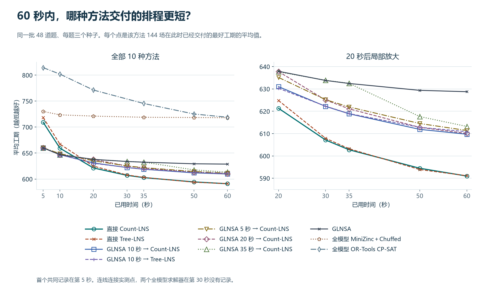

# 柔性作业车间调度｜邻域选择与 CP-SAT 局部修复

**柔性作业车间调度（FJSP）**给定一组作业，每个作业由一串顺序固定的工序组成。对每道工序 $o$，输入给出合格机器集合 $M_o$，以及它在每台合格机器 $m$ 上的加工时长 $p_{o,m}$。排程要选定一台机器 $m_o \in M_o$ 和一个非负整数开工时刻 $s_o$。工序在选定机器上连续加工，完工时刻为 $C_o = s_o + p_{o,m_o}$。

- **作业内先后顺序。** 若工序 $u$ 紧接工序 $o$，则 $s_u \ge C_o$。
- **机器容量。** 分配到同一台机器的工序，其加工区间 $[s_o, C_o)$ 互不重叠。
- **目标。** 最小化所有工序中最晚的完工时刻，即工期 $C_{\max} = \max_o C_o$。

例如，作业 A 要先做 A1 再做 A2，作业 B 只做 B1。A1 在机器 1 上耗时 3、在机器 2 上耗时 4。A2 只能在机器 2 上加工 2 个时间单位，B1 只能在机器 1 上加工 4 个时间单位。把 A1 和 B1 分别放在机器 2 和机器 1 上，从时刻 0 同时开始，两道工序都在时刻 4 完工。A2 接着在机器 2 上加工到时刻 6，工期就是 **6**。如果让 A1 先在更快的机器 1 上加工，B1 就要等到时刻 3 才能开工。此时 A2 在时刻 5 完工，B1 在时刻 7 完工，这份排程的工期是 **7**。

本项目求解器先构造一份可行排程，再反复挑一组工序交给 OR-Tools CP-SAT 重新安排。默认方法是 **Count-LNS（计数规则选组修复）**。我们测试了 48 道 **250 或 500 工序**的实例，每场使用**一个求解线程、限时 60 秒**。Count-LNS 相对全模型 OR-Tools CP-SAT 和 MiniZinc＋Chuffed 的逐题中位工期降幅分别为 **10.61%** 和 **9.84%**。

[完整实验报告](docs/benchmark.md) · [方法与参数](docs/algorithms.md) · [测试数据来源](docs/reproduction.md#测试数据来源) · [复现说明](docs/reproduction.md)

## 60 秒实验结果

共 **13 种运行配置、1,872 场**，每种配置使用相同的 48 道题（24 道 Behnke 公共题、24 道 SD2-mix 合成题）和三个种子，每场都在 60 秒内交付了可行排程。下图和表格展示其中 **10 种配置、1,440 场**。“直接”表示 GLNSA 用时为 0 秒，局部修复从最早完工规则生成的排程开始。Count-LNS 另列出 5、10、20、35 秒热启动，Tree-LNS 另列出 10 秒热启动。原九组和四种早切换配置分两次运行，跨批差异按同题同种子作描述性比较。 [完整结果与核验](docs/benchmark.md)

**直接修复的两种方法最接近。** 60 秒时，直接 Count-LNS 和直接 Tree-LNS 的平均工期分别为 **590.99** 和 **591.14**。逐题配对后，Count-LNS 为 27 胜、8 平、13 负，中位降幅为 0.23%。在这批题上，用计数规则选组已经能取得与训练过的树模型相近的终点结果。

**GLNSA 热启动的优势出现在前 10 秒。** 第 10 秒，GLNSA 热启动接 Count-LNS 的平均工期为 **646.92**，优于直接 Count-LNS 的 **659.44**。到第 20 秒，两者分别为 **631.04** 和 **621.35**，直接修复已领先。四个热启动时点里，10 秒切换到 Count-LNS 的 60 秒平均工期最低（**609.73**），直接 Count-LNS 仍在两者配对的 48 题中赢了 36 题。

### 各方法在第 10、20、60 秒的工期

按 60 秒平均工期从小到大排列，每行均为 144 场。最后两列均从**直接 Count-LNS** 的角度读。例如，相对 GLNSA，它在 44 道题上工期更短，1 道相同，3 道更长。降幅以对照行的工期为分母，每题先取三个配对种子的中位降幅，再取 48 题的中位数。

| 方法 | 批次 | 10 秒平均工期 | 20 秒平均工期 | 60 秒平均工期 ↓ | 直接 Count-LNS 的逐题中位降幅 | 直接 Count-LNS 胜／平／负 |
| --- | --- | ---: | ---: | ---: | ---: | ---: |
| 直接 Count-LNS | 正式 | 659.44 | 621.35 | 590.99 | — | — |
| 直接 Tree-LNS | 正式 | 667.24 | 624.84 | 591.14 | 0.23% | 27／8／13 |
| GLNSA 10 秒 → Count-LNS | 补充 | 646.92 | 631.04 | 609.73 | 2.54% | 36／0／12 |
| GLNSA 20 秒 → Count-LNS | 正式 | 646.74 | 637.78 | 610.06 | 2.92% | 35／0／13 |
| GLNSA 10 秒 → Tree-LNS | 补充 | 646.86 | 630.29 | 610.85 | 2.60% | 36／1／11 |
| GLNSA 5 秒 → Count-LNS | 补充 | 648.85 | 635.17 | 611.40 | 2.61% | 34／0／14 |
| GLNSA 35 秒 → Count-LNS | 正式 | 646.78 | 637.67 | 613.21 | 3.93% | 36／1／11 |
| GLNSA | 正式 | 646.83 | 637.90 | 628.78 | 6.95% | 44／1／3 |
| 全模型 MiniZinc＋Chuffed | 正式 | 723.60 | 721.15 | 718.06 | 9.84% | 48／0／0 |
| 全模型 OR-Tools CP-SAT | 正式 | 802.01 | 771.32 | 718.97 | 10.61% | 48／0／0 |

在 24 道 Behnke 公共题的 72 场运行中，按 FJSPLib 收录的上下界估算，直接 Count-LNS 与最优工期的相对差距中位数介于 **4.32% 和 5.17%**。 [逐题上下界与来源](docs/benchmark.md) · [重算首页表格](analysis/overview.py)

## 求解器怎样工作

### 1. 用最早完工规则生成初始排程

每个作业先拿出下一道待排工序。对每道工序，逐台检查题目指定的可用机器。把工序接到某台机器的队尾时，它必须等作业的前一道工序做完，也必须等这台机器空出来。在两个时刻中取较晚的一个，再加上该机器的加工时长，就得到这项安排的完工时刻。程序选出完工最早的工序和机器，更新作业进度和机器队尾，重复直到排完。 [初排程代码](engine/baseline.py)

### 2. 从当前排程各生成一个时间窗和并行块

把排程想成一张甘特图。每道工序在图上占据一段加工时间。时间窗先选一段时间，再找经过这段时间的工序。并行块先选一道工序，再顺着加工时段的重叠关系扩展。两种方法都查看所有机器上的工序，来源是 Kasapidis 等人的 ALNS-CP。 [论文](https://doi.org/10.1016/j.ejor.2024.08.010)

- **时间窗。** 先确定窗口宽度，再在能容纳整个窗口的范围内均匀随机抽取起点。把当前加工时段与窗口相交的工序全部放进候选组，刚好碰到端点也算。比如抽到 `[20, 30]`，那么 `[16, 20]`、`[23, 28]` 和 `[30, 36]` 上的工序都会入组。组里有几道工序，取决于窗口落在排程的什么位置。 [时间窗代码](engine/alns_neighborhoods.py)
- **并行块。** 先均匀随机抽一道工序作为起点，再找加工时段与它相交的工序，端点相接也算。程序打乱这批工序的顺序，依次加入组里，并按加入顺序继续检查它们的时段。例如，A 在 `[10, 18]`，B 在 `[16, 24]`，C 在 `[22, 28]`。从 A 出发先找到 B，再通过 B 找到 C。达到目标道数时停止。如果从已选工序出发再也找不到新工序，就用已选到的那几道。 [并行块代码](engine/experiments/candidate_study_pool.py)

两个候选在同一轮共用一个规模比例。初始比例是 20%，各自取一半来设定规模。例如，当前工期是 100 个时间单位、共有 250 道工序，初始窗口宽度就是 10 个时间单位，并行块最多选 25 道工序。后续比例根据修复结果调整，并行块的道数上限向上取整。 [规模调整规则](docs/algorithms.md)

### 3. 按工序可用的机器数选一组

**合格机器由题目的输入数据指定。** 输入为每道工序列出能加工它的机器，以及在每台机器上的加工时长。例如，工序 A 可以在机器 1 上加工 6 个时间单位，也可以在机器 3 上加工 9 个时间单位，那么 A 有两台合格机器。选组时两台各计一次，当前排程把 A 放在哪台机器上都一样。求解器按时间约束排除机器选项是在选组之后。 [输入解析](engine/fjsp.py) · [选组代码](engine/experiments/tree8_confirmation_runtime.py)

**Count-LNS** 把组内每道工序的合格机器数相加。假设时间窗选了两道工序，各有 3 台和 4 台合格机器，总数是 7。并行块选了三道工序，各有 2 台、1 台和 2 台合格机器，总数是 5。即使并行块的工序更多，Count-LNS 仍选总数较少的并行块。两道工序都能用机器 1 时，这台机器在两道工序的计数里各算一次。总数相同则在两组中均匀随机选一组。**Tree-LNS（树模型选组修复）**使用同样的候选构造方法，由训练好的树模型打分后选组。 [树模型与训练目标](docs/algorithms.md)

### 4. 用 CP-SAT 重新安排选中的工序

选中的工序可以换到合格机器上，也可以插入机器队列的其他位置。其余工序保留原机器和彼此的先后顺序，开工时间仍可随排程改变。求解器用作业前序和保留的机器顺序计算工序能在哪段时间内开工，再搜索工期更短的排程。单次修复最多 3 秒，包含约束预处理和建模。新排程通过独立检查且工期缩短后，才成为下一轮的起点。 [局部修复模型](engine/experiments/cp_rebuild_model.py) · [排程检查](engine/fjsp.py)

## 目录导览

| 路径 | 内容 |
| --- | --- |
| [`docs/`](docs/) | 方法说明、实验报告、图表与复现环境。 |
| [`engine/`](engine/) | 初排程、数据读取、排程检查、48 道测试题清单，以及两批实验的运行顺序和参数。 |
| [`engine/experiments/`](engine/experiments/) | 双候选构造、选组、CP-SAT 局部修复、GLNSA、全模型求解和两批实验的运行代码。 |
| [`engine/weights/`](engine/weights/) · [`engine/legacy/`](engine/legacy/) | Tree-LNS 的模型权重，以及旧候选池方法的实现与权重。 |
| [`results/`](results/) | 每场运行的工期和时间检查点、逐题上下界、汇总统计与核验记录。 |
| [`analysis/`](analysis/) | 从逐场结果重算统计和图表的脚本。 |
| [`reproduce.py`](reproduce.py) · [`requirements-linux.txt`](requirements-linux.txt) | 两批实验的复跑入口和 Python 依赖。 |

## 核对数字与复跑

在仓库根目录运行 `python analysis/summarize.py` 可重算原九组 1,296 场的结果，运行 `python analysis/early_switch.py` 可重算补充实验 576 场的结果。运行 `python analysis/overview.py` 可从两批逐场记录重算首页表格。三个脚本均只需 Python 标准库。 [正式实验数据](results/observations.jsonl) · [补充实验数据](results/early-switch.jsonl) · [运行命令与依赖版本](docs/reproduction.md)
