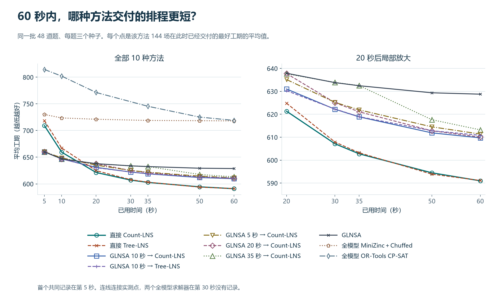
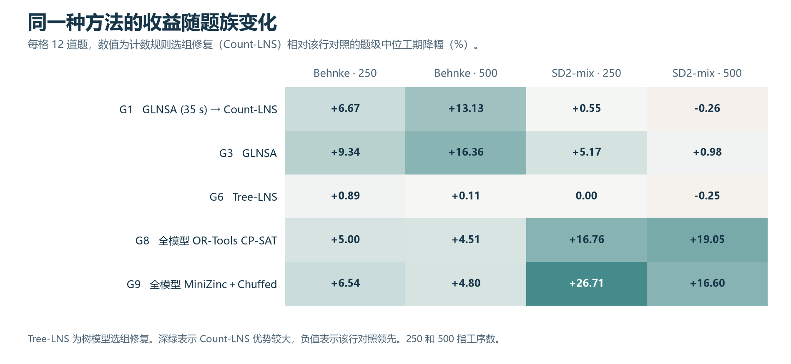
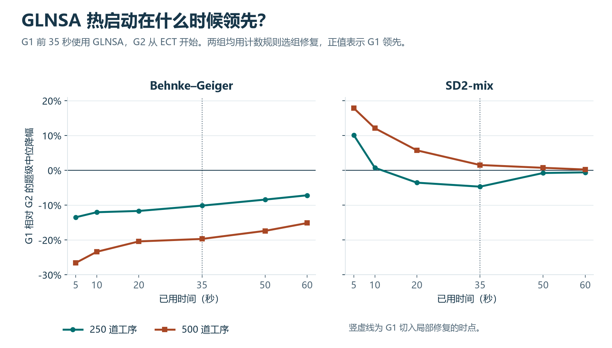

# 单核 60 秒柔性作业车间调度实验

**计数规则选组修复（Count-LNS）的 60 秒平均工期为 590.99，在 13 种配置中最低。** 它相对全模型 OR-Tools CP-SAT 和全模型 MiniZinc＋Chuffed，在各自的 144 个同题同种子配对中都交付了更短的工期。树模型选组修复（Tree-LNS）的平均工期为 591.14。以 GLNSA 起步的组合中，第 10 秒接 Count-LNS 的终点平均工期最低，为 609.73。

实验覆盖 48 道题、三个种子、13 种配置，**1,872 场合格**。原九组先运行，随后在同一批题目追加第 5 秒和第 10 秒交接的四种组合。方法、参数、组号和运行标识在同一页。 [算法实现与文献](algorithms.md) · [复现说明](reproduction.md)

## 一场怎么计分

目标是最小化工期，即最后一道工序的完工时刻。测试集包括 24 道 Behnke–Geiger 公共题和 24 道 SD2-mix 合成题。每类有 12 道 250 工序题、12 道 500 工序题，每题用种子 42、43、44。每场单独计时，初始化、选组、建模、搜索、验解、交付及回收均计入 60 秒。取截止前已验解并发布的最小工期。 [基准出处、选题与生成规则](reproduction.md#测试数据来源)

原九组在同题同种子下占用同一逻辑 CPU 并轮换顺序。早切换的四组在观察原曲线后运行，沿用同一批题，先跑 Count-LNS 的两个时点，再跑 Tree-LNS 的两个时点。每阶段内，同题同种子的两个时点在同一逻辑 CPU 上按计划轮换顺序。跨阶段及跨批比较按题目和种子配对，作为描述性结果。 [实例指纹](../engine/cases.json) · [原九组顺序](../engine/final60-blocks.json) · [早切换顺序](../engine/early-blocks.json)

每道题的比较从三个相同种子开始。对每对运行，用 `100 × (基线工期 − 方法工期) / 基线工期` 计算降幅，再取这三个值的中位数。表中的中位降幅和胜／平／负都按这 48 个逐题结果计算。区间按题目来源和规模分成四层，在每层有放回抽样，共计算 10,000 次。四个预先登记的主要比较用 Bonferroni 校正后的 98.75% 区间，其余比较用描述性 95% 区间。 [原九组统计](../analysis/summarize.py) · [早切换统计](../analysis/early_switch.py)

## 60 秒工期

直接 Count-LNS 在 Behnke 两档规模的平均工期最低。SD2-mix 的 250 工序题上，GLNSA 5 秒后接 Tree-LNS 最低。500 工序题上，GLNSA 20 秒后接 Count-LNS 最低。

13 种配置的终点工期与分层均值

每组 144/144 场合格。四个分层列分别是 36 场的平均工期，越小越好。最后一列是完成一场的实际用时中位数。

| 组 | 方法 | 总均值 | Behnke 250 | Behnke 500 | SD2-mix 250 | SD2-mix 500 | 秒 |
| --- | --- | ---: | ---: | ---: | ---: | ---: | ---: |
| G1 | GLNSA 35 秒 → 计数规则选组修复 | 613.21 | 249.2 | 484.8 | 571.8 | 1147.0 | 57.71 |
| G2 | 计数规则选组修复 | **590.99** | **231.9** | **414.1** | 569.1 | 1148.9 | 57.71 |
| G3 | GLNSA | 628.78 | 257.4 | 499.0 | 598.2 | 1160.5 | 57.61 |
| G4 | GLNSA 20 秒 → 计数规则选组修复 | 610.06 | 246.9 | 480.7 | 569.9 | **1142.8** | 57.71 |
| G5 | GLNSA 35 秒 → 树模型选组修复 | 613.97 | 248.6 | 487.6 | 573.3 | 1146.4 | 57.71 |
| G6 | 树模型选组修复 | 591.14 | 233.9 | 414.5 | 570.3 | 1145.8 | 57.72 |
| G7 | 旧候选池选组修复 | 811.19 | 234.1 | 416.4 | 839.0 | 1755.2 | 59.32 |
| G8 | 全模型 OR-Tools CP-SAT | 718.97 | 244.8 | 433.1 | 706.2 | 1491.8 | 59.25 |
| G9 | 全模型 MiniZinc＋Chuffed | 718.06 | 248.4 | 434.7 | 793.2 | 1396.0 | 58.46 |
| G10 | GLNSA 5 秒 → Count-LNS | 611.40 | 247.0 | 482.0 | 569.0 | 1147.6 | 57.71 |
| G11 | GLNSA 10 秒 → Count-LNS | 609.73 | 246.3 | 480.1 | 568.0 | 1144.5 | 57.71 |
| G12 | GLNSA 5 秒 → Tree-LNS | 612.55 | 246.1 | 487.6 | **567.1** | 1149.3 | 57.71 |
| G13 | GLNSA 10 秒 → Tree-LNS | 610.85 | 245.2 | 483.2 | 568.8 | 1146.2 | 57.71 |

G7 旧候选池选组修复（Legacy-LNS）用于和项目旧版做端到端比较。它同时使用另一套候选池、排序模型、单次修复时限及随机续搜策略。G2 对 G7 的追加配对中位降幅为 +6.22%，描述性 95% 区间为 [+5.63%, +15.87%]，43 胜、1 平、4 负。Behnke 两档中位降幅为 1.49% 和 0.37%，SD2-mix 两档为 31.33% 和 35.01%。

查看 13 种配置的逐时点平均工期

每个数都来自 144 场运行。全部配置共有 5、10、20、35、50、60 秒六个检查点，G1 至 G6 和 G10 至 G13 另有第 30 秒的工期。上图保留直接运行和第 10 秒接手的 Tree-LNS，所有运行的检查点都列在下表。 [原九组逐场记录](../results/observations.jsonl) · [早切换逐场记录](../results/early-switch.jsonl)

| 组 | 5 秒 | 10 秒 | 20 秒 | 30 秒 | 35 秒 | 50 秒 | 60 秒 |
| --- | ---: | ---: | ---: | ---: | ---: | ---: | ---: |
| G1 | 659.97 | 646.78 | 637.67 | 633.88 | 632.51 | 617.64 | 613.21 |
| G2 | 709.22 | 659.44 | 621.35 | 607.15 | 602.76 | 594.49 | 590.99 |
| G3 | 659.98 | 646.83 | 637.90 | 633.81 | 632.46 | 629.38 | 628.78 |
| G4 | 660.01 | 646.74 | 637.78 | 625.06 | 621.09 | 612.81 | 610.06 |
| G5 | 660.01 | 646.82 | 637.85 | 633.76 | 632.50 | 617.22 | 613.97 |
| G6 | 718.41 | 667.24 | 624.84 | 607.90 | 603.23 | 593.90 | 591.14 |
| G7 | 848.65 | 845.28 | 837.08 | — | 825.31 | 815.96 | 811.19 |
| G8 | 814.45 | 802.01 | 771.32 | — | 745.47 | 725.21 | 718.97 |
| G9 | 730.08 | 723.60 | 721.15 | — | 718.94 | 718.44 | 718.06 |
| G10 | 660.21 | 648.85 | 635.17 | 625.20 | 621.93 | 614.53 | 611.40 |
| G11 | 660.28 | 646.92 | 631.04 | 622.21 | 618.87 | 611.90 | 609.73 |
| G12 | 660.19 | 648.24 | 634.90 | 625.94 | 622.31 | 615.16 | 612.55 |
| G13 | 660.15 | 646.86 | 630.29 | 622.30 | 618.96 | 612.83 | 610.85 |

第 5 秒，以 GLNSA 起步的配置平均工期约 660，直接 Count-LNS 为 709.22。第 10 秒，10 秒后接 Count-LNS 的平均工期为 646.92，直接 Count-LNS 为 659.44。到第 20 秒，直接 Count-LNS 为 621.35，10 秒后接 Count-LNS 为 631.04。直接修复的两条曲线后段接近，第 50 秒 Tree-LNS 略低，第 60 秒 Count-LNS 略低。

### 35 秒热启动的实验结果

35 秒热启动后接 Count-LNS，在 48 题上全部胜过独立运行的 GLNSA，逐题工期中位降幅为 2.95%。与直接运行 Count-LNS 相比，热启动组是 11 胜、1 平、36 负，其中 28 题的工期增加超过 2%。

完整预登记对照、区间与判定门槛

| 对照（前者对后者） | 题级中位降幅 | 区间 | 胜／平／负 |
| --- | ---: | ---: | ---: |
| G1 对 G2，同后程、ECT 起步 | −4.11% | [−4.74%, −3.55%] | 11／1／36 |
| G1 对 G3，GLNSA | +2.95% | [+2.05%, +3.51%] | 48／0／0 |
| G1 对 G7，旧候选池选组修复 | +2.40% | [+1.77%, +12.26%] | 24／0／24 |
| G1 对 G8，全模型 OR-Tools CP-SAT | +6.78% | [+5.35%, +8.18%] | 26／0／22 |
| G1 对 G4，35 秒与 20 秒切换 | −0.44% | [−0.82%, −0.34%] | 6／5／37 |
| G5 对 G1，同热启动，树与规则 | 0.00% | [0.00%, 0.00%] | 15／16／17 |
| G6 对 G2，同 ECT，树与规则 | −0.23% | [−0.45%, 0.00%] | 13／8／27 |
| G1 对 G9，全模型 MiniZinc＋Chuffed | +6.91% | [+6.44%, +7.19%] | 28／2／18 |

前四行是关键比较。G1 同时胜过两条单独路线的假设未通过。预登记的实质收益门槛要求相对 G2、G7、G8 三组分别至少降低 3%、至少改善 32 题、退化超过 2% 的题最多 4 道，并满足区间与规模要求。仅 G1 对 G2 就有 **28 题**退化超过 2%，最大退化 **24.83%**。G1 对 G7、G8 虽有正中位数，胜题数也低于 32。 [预登记统计与门槛代码](../engine/experiments/final60_report.py)

### Count-LNS 与其他方法的比较

下表列出正式实验结束后，对 Count-LNS 与各基线做的追加配对分析。

| G2 的对照 | 题级中位降幅 | 描述性 95% 区间 | 胜／平／负 |
| --- | ---: | ---: | ---: |
| G3，GLNSA | +6.95% | [+6.37%, +7.09%] | 44／1／3 |
| G6，树模型选组修复 | +0.23% | [0.00%, +0.45%] | 27／8／13 |
| G8，全模型 OR-Tools CP-SAT | +10.61% | [+9.83%, +11.23%] | 48／0／0 |
| G9，全模型 MiniZinc＋Chuffed | +9.84% | [+8.70%, +11.48%] | 48／0／0 |

相对共同的最早完工初排程，Count-LNS 的逐题中位工期缩短 **18.92%**，48 题均获改善。Count-LNS 与全模型 OR-Tools CP-SAT 都从同一初排程出发。Count-LNS 在四个题目分层上都取得了正的中位降幅，这反映了候选构造、选组、局部建模和反复修复的整体效果。

两类测试题上的差异很大。全模型 MiniZinc＋Chuffed 在 Behnke 的 72 场中都保留了初排程，在 SD2-mix 的 72 场中都改善了初排程。全模型 OR-Tools CP-SAT 有 114 场改善初排程。在 500 道工序的 SD2-mix 题上，Count-LNS 相对独立运行的 GLNSA 的逐题中位降幅是 0.98%。 [逐场数据](../results/observations.jsonl)

### 为什么热启动在开发集看起来有用

原开发批只有 8 道已曝光的 **SD2-mix 500**，每题两个种子。35 秒热启动对 ECT 起步的题级中位优势为 +0.47%，描述性区间 [−0.89%, +3.06%]。正式留出集同族同规模的 12 道新题仍给出 **+0.26%**、7 胜 5 负。扩大到四个分层后，另外三层改变了总体方向。

| G1 相对 G2 的题级中位降幅 | 5 秒 | 20 秒 | 35 秒交接 | 60 秒 | 终点胜／平／负 |
| --- | ---: | ---: | ---: | ---: | ---: |
| Behnke 250 | −13.45% | −11.64% | −10.11% | −7.14% | 0／0／12 |
| Behnke 500 | −26.55% | −20.39% | −19.68% | −15.11% | 0／0／12 |
| SD2-mix 250 | +10.14% | −3.52% | −4.66% | −0.55% | 4／1／7 |
| SD2-mix 500 | +17.88% | +5.76% | +1.56% | +0.26% | 7／0／5 |

35 秒时，G1 在 37 题落后，其中 32 题到终点仍落后。24 道 Behnke 在交接及终点均落后。SD2-mix 500 上，G1 在交接时领先 11/12，到了终点仍领先 7/12。与此同时，G1 有 **143/144 场**在交接后继续改善了自己的排程。两条路线的修复调用中位数是 G1 **28.5**、G2 **53**。后程修复确实有效，但前 35 秒给后程留下的起点和时间随题族产生了不同代价。G4 比 G1 更常胜出，说明 20 秒在这两个已测时点间更有利，连续时点的最优选择仍未知。

### 5、10、20、35 秒交接怎样比较

原实验发现 GLNSA 在前段给出的平均工期较短，因此进一步测试了 5 秒和 10 秒交接。按事先设定的规则，先计算 48 道题的 Count-LNS 配对结果，10 秒组逐题中位降幅为正就选 10 秒，持平或落后时选 5 秒。选定时点后，再看同一时点的 Tree-LNS。表中正值表示前者工期更短，四组早切换与原实验的结果按题目和种子配对。

| 60 秒终点比较 | 逐题中位降幅 | 描述性 95% 区间 | 胜／平／负 |
| --- | ---: | ---: | ---: |
| 10 秒 Count-LNS 对 5 秒 Count-LNS | +0.17% | [0.00%, +0.43%] | 26／10／12 |
| 10 秒 Count-LNS 对原 20 秒 Count-LNS | +0.18% | [0.00%, +0.30%] | 27／10／11 |
| 10 秒 Count-LNS 对原 35 秒 Count-LNS | +0.77% | [+0.48%, +1.10%] | 34／0／14 |
| 10 秒 Count-LNS 对原直接 Count-LNS | −2.62% | [−3.53%, −2.28%] | 12／0／36 |
| 10 秒 Tree-LNS 对 10 秒 Count-LNS | −0.32% | [−0.54%, 0.00%] | 16／4／28 |

选中的 10 秒组里，Tree-LNS 的平均工期为 **610.85**，Count-LNS 为 **609.73**。两个阶段分别从零运行 GLNSA，144 对运行中有 122 对交给后段的排程完全相同。

5 秒时树模型和计数规则的排序为何不同？

5 秒 Tree-LNS 对同一时点的 Count-LNS 是 26 胜、3 平、19 负，逐题中位降幅 **+0.18%**，描述性 95% 区间 **[−0.21%, +0.43%]**。按每题三个种子的中位数比较，树模型在 250 工序的 Behnke 题上 9 胜 3 负，在 500 工序的 Behnke 题上 3 胜 9 负。全部 144 场直接取平均，5 秒 Tree-LNS 与 Count-LNS 的工期分别为 612.55 和 611.40。平均工期保留绝对工期差的大小，逐题中位数衡量相对变化，两种指标在这里给出不同排序。

与选中的 **10 秒 Count-LNS** 直接配对时，5 秒 Tree-LNS 的逐题中位降幅为 **−0.19%**，20 胜、3 平、25 负。 [早切换逐场记录](../results/early-switch.jsonl) · [全部配对与区间](../results/early-switch-statistics.json)

#### 10 秒热启动在不同题型上的表现

| 题型（每层 12 题） | 10 秒 Count-LNS 相对直接 Count-LNS 的逐题中位降幅 | 胜／平／负 |
| --- | ---: | ---: |
| Behnke，250 工序 | −6.46% | 0／0／12 |
| Behnke，500 工序 | −14.93% | 0／0／12 |
| SD2-mix，250 工序 | +0.17% | 7／0／5 |
| SD2-mix，500 工序 | −0.29% | 5／0／7 |

在 24 道公共基准题上，直接修复全部胜出，500 工序题的差距尤其明显。在合成题上两种路线各胜 12 题。以这两类题和 60 秒预算为应用范围，默认采用直接 Count-LNS。

### 学习排序带来了什么

Tree-LNS 和 Count-LNS 共用初排程、候选构造方式和修复器。Tree-LNS 在 13 题上工期更短，在 8 题上持平，在 27 题上工期更长。两者接在 35 秒热启动之后时，有 130 对运行的交接排程完全相同。这些配对里，换成树模型后第 60 秒的工期降幅中位数为零。

每场用于选组的总耗时，Tree-LNS 的中位数为 **0.222 秒**，Count-LNS 为 **0.038 秒**。每场调用修复器的次数中位数分别为 **41.5** 和 **53**，包括工期保持原值的调用。两种方法每次选组都会决定下一轮要修复的排程。

## 与最优工期的差距

24 道 Behnke 公共题采用 FJSPLib 档案记录的上下界，其中 3 道的档案上下界相等。24 道 SD2-mix 合成题采用从输入计算的工期下界。 [逐题上下界](../results/bounds.json) · [档案来源](reproduction.md)

用可行工期作为最优工期的上界，用确定的工期下界作为另一端，就能限制最优工期的范围。对每场 Count-LNS 运行，用这两个界分别计算相对差距的下限与上限，再分别取中位数。

| Count-LNS 测试题 | 场数 | 与最优工期的相对差距中位数 |
| --- | ---: | --- |
| Behnke 250 | 36 | 4.47%～5.15%，按档案上下界估计 |
| Behnke 500 | 36 | 4.32%～5.17%，按档案上下界估计 |
| Behnke 合计 | 72 | **4.32%～5.17%**，按档案上下界估计 |
| SD2-mix 250 | 36 | 至多 10.75%，按工期下界估计 |
| SD2-mix 500 | 36 | 至多 11.85%，按工期下界估计 |

[可重算的差距分布](../results/statistics.json)

| 档案闭合的公共题 | 档案下界＝上界 | 下界来源／上界来源（档案字段） | G2 三种子中位工期 | 相对档案最优值的差距 |
| --- | ---: | --- | ---: | ---: |
| behnke33 | 224 | CP-SAT／OptalCP | 235 | 4.91% |
| behnke52 | 211 | CP-SAT／ToukoUrsin2026b | 223 | 5.69% |
| behnke60 | 397 | DOFP2026a／ToukoUrsin2026b | 416 | 4.79% |

查看全部 48 题的本轮下界和可用档案上下界

每行并排列出四道独立实例。“档案界”列按下界到上界的顺序列出。两个规模的完整实例名分别为 `sd2mix-test-25x10-编号` 和 `sd2mix-test-50x10-编号`。 [逐题数据](../results/bounds.json)

| Behnke 250 | 本轮下界 | 档案界 | Behnke 500 | 本轮下界 | 档案界 | SD2-mix 编号 | 250 本轮下界 | 500 本轮下界 |
| --- | ---: | ---: | --- | ---: | ---: | --- | ---: | ---: |
| behnke11 | 163 | 223–228 | behnke16 | 327 | 392–412 | 60000 | 497 | 977 |
| behnke14 | 164 | 221–230 | behnke17 | 320 | 392–401 | 60001 | 501 | 1046 |
| behnke15 | 159 | 220–228 | behnke20 | 322 | 391–398 | 60002 | 485 | 1028 |
| behnke32 | 77 | 220–224 | behnke36 | 152 | 381–388 | 60003 | 561 | 980 |
| behnke33 | 77 | 224–224（闭合） | behnke37 | 153 | 387–391 | 60004 | 461 | 1041 |
| behnke34 | 78 | 219–223 | behnke38 | 151 | 387–389 | 60005 | 556 | 1001 |
| behnke35 | 79 | 211–214 | behnke39 | 153 | 384–389 | 60006 | 501 | 1086 |
| behnke51 | 75 | 215–218 | behnke40 | 156 | 415–419 | 60007 | 518 | 976 |
| behnke52 | 76 | 211–211（闭合） | behnke56 | 99 | 384–390 | 60008 | 550 | 1042 |
| behnke53 | 74 | 212–215 | behnke57 | 99 | 385–390 | 60009 | 521 | 1115 |
| behnke54 | 75 | 221–223 | behnke58 | 100 | 392–397 | 60010 | 472 | 928 |
| behnke55 | 77 | 221–223 | behnke60 | 101 | 397–397（闭合） | 60011 | 541 | 1062 |

工期下界取以下三项中的最大值。第一项按每道工序的最短耗时计算最长作业链。第二项把全部工序的最短耗时相加，除以机器数后向上取整。第三项统计每台机器必须独自承担的加工时间，取其中最大的值。逐题核对后，全模型求解器返回的下界都在这一数值以内。

## 结果如何核验

正式实验包含 144 个区组。每个区组在同一逻辑处理器上运行相同题目、相同种子的九种方法。有 7 个区组受到处理器争用影响，共排除 9 次尝试，随后换核整组重跑并通过检查。1,296 场计分运行均通过排程检查与计时检查，最长用时 59.755 秒。

同核配对控制了换核和明显争用，共享服务器仍有调度波动。五个使用新局部 CP 修复的组有原生运行队列等待计数，合计 720 场。其中 28 场的单次最大等待达到 100 毫秒（G2 有 11 场，G6 有 17 场），均未同时达到协议规定的核心占用排除条件。其余四组沿用同一 CPU 监测，但缺少这项原生计数。对亚百分点差异需保留这层不确定性。 [争用判据](../engine/experiments/stop8_shared_cpu.py)

回传核验覆盖原始记录指纹、区组及种子顺序、48 份输入和工期下界。这里的逐场表保留原记录指纹，可直接用于重算报告中的 60 秒结果。

早切换的 288 个合格区组共 576 场。3 次尝试因处理器争用被排除，随后整对重跑。核验覆盖计分场次和被排除尝试中已写入的记录，共 581 条。 [原九组核验摘要](../results/audit.json) · [早切换核验摘要](../results/early-switch-audit.json) · [复核与复跑入口](reproduction.md)
